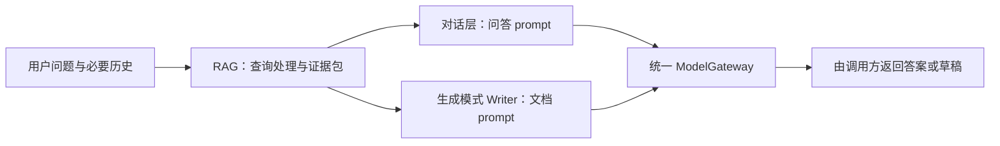

# RAG 优化实验复盘与关键结论

2026-09-17 新增 [修复与三范围复测](rag-repair-and-retest-2026-09-17.md)：修复查询拆解、扩展生成证据覆盖、增加表格下限求和及记录边界约束。最终全库 Recall@5 保持 76.19%，事实覆盖从 31/42 提升到 40/42；仍存在拒答协议、检索、单位表达和一次 JSON 输出失败，不能宣称闭环验收通过。以下为此前实验记录。

日期：2026-09-15。依据：`wd` 实测 JSON、历史实施记录、当前检索代码。本文总结已有实验，不代表重新运行了评测。

## 1. 当前结论

目前最明确的改善来自三个方面：修复混用的非生产向量、校正评估文档范围、增加中文短语与数字证据重排。扩大候选窗口、机械拆解查询、强制保留兄弟块没有稳定改善最终 Top5。

最新 H 实验：Recall@5 **0.9125**、MRR@5 **0.8717**、nDCG@10 **0.8482**，超过本轮 0.85 的召回目标，也通过报告内 0.90/0.80/0.80 的三项门禁。

但这只说明当前固定评估集上的搜索结果达标：多跳 Top5 证据完整率为 7/10，最终上下文完整率只有 5/10；拒答、答案正确性和实际抗干扰能力尚未完成验证。不能据此宣称完整 RAG 已验收。

## 2. 阅读实验结果的口径

- 评估集有 50 条，其中 40 条可回答样本参与检索指标，10 条拒答样本另计。每种题型只有约 10 条，小幅波动不足以证明普遍有效。
- Recall@5 衡量标准证据覆盖；多跳题命中一个证据不等于完整命中。MRR 主要看首个相关结果，不足以单独评价多跳能力。
- 项目历史字段 `mmr@5` 是 `mrr@5` 的兼容别名，不是 MMR 多样性算法指标。
- 重切分、更换 gold chunk ID、改变 documentId 过滤范围，会改变评测条件。跨版本指标只能作阶段记录，不能全部归因于某一算法。
- 下文“有效”指已有本地实验增益；机制解释分为代码可确认的事实和待消融验证的推断。未提升标记为“存疑”，不等于该方向永远无效。

## 3. 数据、切分与检索基础设施

| 尝试 | 观察到的结果 | 为什么有效或无效；关键点 |
|---|---|---|
| 35 条基础问答扩展为 50 条、多文件、多类型评估集 | 加入拒答、多跳、同维度比较与混淆样本；后续随层级 chunk 更新引用 | 改善测试覆盖，但不是算法增益。自然提问、答案闭环、gold 完整性比模板数量更重要；混淆应在 context 注入，而非写进 query |
| 按评估引用保留版本并去重 | 历史清单记录删除未被评估引用、内容完全重复的文档 PK 32、43 | 减少重复版本和 ID 歧义；没有独立对照证明去重本身提升 Recall。仍须区分不同 UUID 的等价证据与真正错误证据 |
| pgvector + PostgreSQL 词法兼容路径 + 表格 SQL | 早期未过滤口径 Recall 0.4250 → 0.4000 | 三路接通不代表三路互补。相似模板、同页无关表格块进入融合，会挤占正确证据 |
| 正式接入 Elasticsearch BM25 | 当时 BM25 单路模式 0.5625，Auto 0.5500，Vector 0.6250 | 验证了 BM25 可用，但未证明自动融合优于单路。不能把这个结果归结为“中文天然不兼容” |
| 标题→段落→句子→逗号→空白→字符的递归切分 | 发现旧 child P90 约 1007 字符、最长约 4996；建立递归降级策略 | 缩小过长块有助于聚焦证据，但切分代码只影响后续入库；未重建数据库和 ES 时，复评可完全不变 |
| 严格父 1000 / 子 250 字符，重建父子关联 | 历史重灌统计：3721 parent、8964 child；parent 最大 985、child 最大 250 | 显式 parent UUID 修复多父块关系；小块检索、父块回填形成基础。但同时改变了语料和 gold，不存在充分的“只改块长”消融，不能断言 250 是最优 |
| 全量修复生产 embedding | 层级初评 Auto 0.4500、Vector 0.1000；修复后 Auto 0.7750、Vector 0.7000 | 历史记录发现 7002 条 mock 向量混入。向量非空不等于语义向量；统一生产模型并重算才恢复语义能力。该问题已处理，不应反复用它解释后续约 0.71 的结果 |

上表早期指标来自不同阶段，尤其切分前后评估集发生变化。生产向量修复的记录明确保持 chunk、ID、切分参数与 RRF 配置不变，其因果证据相对更强。

## 4. Query、候选窗口、父子块与 SQL 的尝试

下表三指标依次为 Recall@5 / MRR@5 / nDCG@10，均保留四位小数。报告文件名可在文末索引定位。

| 实验/方案 | 实测三指标 | 判断与关键原因 |
|---|---|---|
| 第一层规则重排；保守重排 | 两份均 0.7375 / 0.6300 / 0.6514 | 保守版本未产生增益。旧 token 正则可把连续中文当作一个长 token，整句覆盖/整句短语匹配对自然中文问题较难命中 |
| Query transform 初版 | 0.7375 / 0.6300 / 0.6514 | 与对应重排报告相同，没有新增收益证据 |
| Query transform final | 0.6375 / 0.5071 / 0.5524 | 明显退化。拆解后的局部命中可能失去原始对象与条件，合并时又抢占排名；具体贡献需固定候选消融，不能仅凭名称认定“final”最好 |
| 保留原始 query | 0.6750 / 0.5654 / 0.6210 | 比 final 恢复，但未回到先前水平。仅把原问题放回列表不保证排名优先 |
| 原 query 优先、子 query 加权 | 0.7125 / 0.6154 / 0.6523 | 比前两版恢复；对应开关消融：开启 Recall 0.7125，关闭 0.7375，仍有负增益。不能认定 query 改写已优化成功 |
| Step1 证据覆盖保护 | 0.7125 / 0.6154 / 0.6523 | 无指标增益，存疑。规则无法找回候选窗口外的证据，也不一定对应实际掉落环节 |
| Step2 兄弟块扩展 | 0.7125 / 0.6154 / 0.6523 | 无指标增益，存疑。相邻或同父不等于相关；补充内容与补回可计分 child ID 是不同事情 |
| Step3 Structured SQL 改进 | 0.7250 / 0.6342 / 0.6615 | 相比 Step2 三项小幅上升，作为后续旧口径基线。支持进一步约束结构化关联，而非盲目加表格候选；具体 SQL 子改动贡献尚无独立消融 |
| A：进一步 query 拆解 | 0.7125 / 0.6342 / 0.6580 | 比 Step3 召回下降，存疑。拆得更多没有解决正确证据进入 Top5 的问题 |
| B：粗召回 Top30 | 0.7250 / 0.6342 / 0.6604 | Recall 未升；多跳 provider 全证据覆盖从 7/10 到 8/10，融合仍 6/10。说明候选有改善，但后续筛选没有保住 |
| BD：Top30 + 融合 Top60 | 0.7250 / 0.6342 / 0.6604 | 相比 B 无改善，存疑。扩大容量本身不能使低位证据进入最终 Top5；需核对实际 trace 确认窗口与截断位置 |
| C1：Structured 直接命中 chunk | 0.7250 / 0.6342 / 0.6615 | 与 Step3 相同，存疑；没有足够证据支持扩大直匹配 |
| D1：数字证据保留 | 0.7250 / 0.6342 / 0.6615 | 无改善，已撤回。仅保护数字不能保证它属于正确对象、字段、单位与条件 |

这些结果支持的结论是：**多跳难点在于多个条件对应的证据能否共同留在有限窗口内，而不是简单把 query 变短、候选变多。**

## 5. 固定文档范围后的 E–H 实验

E 将 gold chunk 映射回所属文档，补全或纠正 `source_document_id`，让搜索请求使用相应 `documentId`。这是文档内检索评估的口径修正，同时降低了全库候选竞争；不能当作全库搜索算法提升。

| 实验 | Recall@5 | MRR@5 | nDCG@10 | 多跳 Top5 完整率 | 最终 context 完整数 |
|---|---:|---:|---:|---:|---:|
| Step3，旧口径 | 0.7250 | 0.6342 | 0.6615 | 0.50 | 5/10 |
| E，文档范围修正基线 | 0.8375 | 0.7979 | 0.8114 | 0.60 | 6/10 |
| F，同父兄弟证据保留 | 0.8375 | 0.7979 | 0.8114 | 0.60 | 6/10 |
| G，Structured 直接 chunk 匹配 | 0.8375 | 0.7875 | 0.8001 | 0.60 | 5/10 |
| H，中文短语 + 数字证据重排 | **0.9125** | **0.8717** | **0.8482** | **0.70** | **5/10** |

### E：主要修正了评估范围

多跳 provider 候选并集完整覆盖从旧口径的 7/10 上升到 10/10。先前部分“Vector/BM25 找不到”实际混入了跨文档竞争或来源约束缺失。该结论适用于已知文档场景；如果线上用户不指定文件，仍需单独做全库评估。

### F：兄弟证据保护没有击中剩余瓶颈

三项指标及最终 context 完整数均不变，已撤回。代码存在父子策略不等于所有兄弟块都会进入候选；第一层保护也不能自动约束第二层 context 选择。此次只能判断该实现无可见增益，不能否定父子检索整体价值。

### G：扩大直匹配增加了排序噪声

总体 Recall 不变，但 MRR 与 nDCG 下降；Structured 单路模式 Recall 从 0.6875 降到 0.4750，最终 context 完整数也下降，已撤回。结果与“直接词面匹配带来更多弱相关块”的解释一致；仍缺候选级消融来量化各 SQL 分支贡献。

关键不是“行级检索不好”，而是是否保留行对象、列名、单位、条件及其关联。命中一个相同数字或通用字段，不等于命中了正确表格记录。

### H：让中文证据真正进入排序分数

当前 `QueryChunkReranker` 增加中文连续片段匹配（多跳宽度 4，其他宽度 5）、弱片段过滤、查询数字匹配与加分上限。在已有候选中，局部相关证据能得到分数，不再过度依赖整句中文 token 完全包含。

相对 E，Recall 增加 **7.50 个百分点**，MRR 增加 **7.38 个百分点**，nDCG 增加 **3.68 个百分点**。已保留；既往执行记录显示定向测试、打包及真实评测通过。

但“只是轻微打破平局”并不准确：RRF k=60 时，三路首位理论合计约为 2.5/61=0.0410，而新增 evidence 加分上限是 0.14，足以显著改变排序。有效机制是增强词面证据影响力，不是已经证明 RRF 始终主导。

此外，中文片段和数字分支没有分别消融，尚不能断言哪个贡献最大。数字使用字符串包含，中文片段先去除非汉字后滑窗，存在数字子串误匹配、跨边界拼接等泛化风险；应在保留集验证后再固化参数。

## 6. 最新结果中不能忽略的边界

### 6.1 报告里的“Vector 指标”不等于原始向量召回指标

Runner 的 `layered_diagnostics` 分别调用 `mode=vector/bm25/structured/auto`；当前服务即使在单路模式下也继续执行融合封装和第一层重排。因此 H 的 Vector 0.9250 是 **Vector 单路模式经过下游排序后的 Top5**，不能解释为 embedding 本身又变强了。

真实候选分层应使用同一次 `diagnostics` 返回的 vector、bm25、structured、fused、reranked、final_context。该路径的完整性统计覆盖各层整个候选列表，不统一等于 Top5；因此 `reranked_complete=9/10` 与多跳 `complete@5=7/10` 不矛盾。

### 6.2 Auto 仍略低于最佳单路模式

H：Vector 单路模式 Recall@5=0.9250，Auto=0.9125，相差 1.25 个百分点；MRR 和 nDCG 也低于该单路。整体达标不等于融合负增益问题已消失，更不能将差距全部归因于原始 RRF，因为两者都经过了下游排序。

### 6.3 Top5 提升没有同步转化为最终证据完整性

H 的多跳漏斗为：provider 并集完整 10/10 → fused 完整 9/10 → reranked 完整 9/10 → final_context 完整 5/10。

互斥分类为 fusion_drop 1 条、context_drop 4 条、complete 5 条。`rerank_drop=0` 仅说明整个 reranked 列表没有再丢 gold，不意味着 Top5 排序完美。

当前 `EvidenceContextReranker` 首轮按 parent 去重，先选不同 parent，未满额才补同父候选，且没有使用 query 参数判断证据需求。这会产生压掉同父不同有效证据的风险。代码机制已确认；每条失败是否由此造成，还需逐条对照证据和最终 prompt 内容。

父块回填也可能已经包含被剔除 child 的文本，所以 child ID 不完整不必然等于 LLM 没看到事实；后续要同时检查 ID 完整性与真实上下文内容覆盖。

### 6.4 查询路由也要独立验收

当前规则意图分类可能漏判自然多跳问题；显式类型解析的别名也未完整覆盖评估集的全部命名。不能因为样本标为 multi_hop，就假设该请求实际执行了多跳 Top20。应记录实际 intent、query 列表、各路限制与融合限制。

## 7. 应保留的经验与下一步优先级

1. **先固定评估契约。** 保存 corpus/index/embedding 版本、gold ID 映射、documentId 范围、请求参数和代码版本；文档内与全库搜索分别报告，避免把范围变化记成算法功劳。
2. **保留已证实的基础修复。** 生产语义向量一致性、递归切分、显式父子关系、ES BM25、Structured 选择性参与和分层 trace 是后续定位的基础；并非每项都已单独证明召回增益。
3. **保留 H 作为当前搜索基线，但补泛化验证。** 用未参与调参的问题验证中文证据重排，增加数字/短语分别关闭的消融；不要用当前 50 条反复调参后再声称独立验收通过。
4. **优先解决 context 证据完整性。** 检查 H 的 4 条 context_drop，改为按证据互补性选择，而非无条件“一个 parent 优先一条”；验收 context 完整性，同时确保搜索三指标不退化。
5. **随后定位那 1 条 fusion_drop。** 固定三路候选，分析真实排名、意图路由和截断；在现有授权基线内优先修门控与排序，不直接改变 RRF 权重。
6. **Query 改写、Top30/60、兄弟块强保留、数字保护、Structured 直匹配暂不视为成功优化。** 针对可复现失败样本提出新机制后再试；无增益的实现不应因复杂度更高而留下。
7. **最后接入答案链路验收。** 检测答案正确性、引用、拒答、条件变异和实际混淆注入；目前报告中的这些指标为 null，不能按通过处理。

Neo4j、完整表格行级检索、学习式或 LLM reranker 属于讨论或待验证方向，不计入已成功方案。当前证据优先支持修复证据选择与评估口径，还不足以证明必须新增知识图谱。

## 8. 证据索引

以下路径均相对于仓库根目录，可按实验名查找对应结果：

- 早期去重与三路对照：`wd/db-dedupe-manifest-2026-09-13.md`、`wd/rag-eval-comparison-2026-09-13.md`。
- 切分与生产向量记录：`docs/chunk-quality-and-recursive-splitting-2026-09-13.md`；报告 `wd/rag-eval-report-hierarchical-2026-09-13.json`、`wd/rag-eval-report-production-embedding-2026-09-13.json`。
- Query/重排：`wd/rag-eval-query-transform*.json`、`wd/rag-eval-rerank*.json`、`wd/rag-eval-ablation-{enabled,disabled}-2026-09-14.json`。
- 分步实验：`wd/rag-eval-step1-coverage-protection-2026-09-14.json`、`wd/rag-eval-step2-sibling-expansion-2026-09-14.json`、`wd/rag-eval-step3-structured-sql-2026-09-14.json`。
- A–H 实验：`wd/rag-eval-exp-*-2026-09-15.json`，其中 B、BD、C1、D1 为独立命名文件。
- 最新报告：[H 实验报告](../wd/rag-eval-exp-h-rerank-evidence-2026-09-15.json)。
- 最新基线数据：`wd/retrieval-eval-50-hierarchical-source-fixed-2026-09-15.jsonl`。
- 评测口径代码：`scripts/run_rag_eval.py`；来源修正：`scripts/fix_eval_source_document_ids.py`。
- 运行链路代码：`backend/src/main/java/com/workpro/rag/` 下的 `RetrievalServiceAdapter.java`、`RetrievalQueryProfile.java`、`QueryChunkReranker.java`、`EvidenceContextReranker.java`。

历史计划中仍有未同步的动态权重、Top30–50 等候选描述。当前实际基线以代码和运行 trace 为准：RRF k=60，Vector/BM25/Structured 权重 1.0/1.0/0.5；多跳配置为每路 Top20、融合 Top20、context Top5。本次仅新增复盘文档，未改动代码、评估集或历史报告。

## 9. 下一阶段目标：RAG 模块完整闭环

> 优先级已调整：当前执行以第 14 节的三个核心任务为准。第 10–13 节保留为后续正式发布验收参考，不再作为接通生成链路的前置任务清单；不要求反复完成全套检索实验才能推进生成。

本节补充后续任务和验收标准。“完美闭环”落实为：在明确业务范围内，文件入库、检索、上下文组装、回答、引用、拒答、异常恢复和评估回归均可重复验证，遗留问题有明确处理；不承诺任意问题零错误。

范围覆盖 PDF/Word/Excel 到用户最终回答，不包含投标协作 Workflow、Writer 等其他模块。当前状态仍是“固定题集、指定文档范围内的检索三指标通过”，不是生成链路验收通过。

标准状态：既有检索硬门禁继续使用 0.90/0.80/0.80；0.85 是本轮优化阶段目标，不替换正式检索门禁。下文新增质量和性能数值是**建议验收基线，待确认**，不能写成已确认或已通过。未执行项、null 指标和缺少证据的项一律不算通过。

## 10. 可执行任务顺序

以下为调整前的完整验收任务清单，当前不按 T1–T10 顺序执行。生成接通后再按实际问题选取必要项。

| 顺序 | 任务与操作 | 必须交付的结果 / 检查点 |
|---|---|---|
| T1 | 冻结 H 回归基线；记录代码、数据、索引、embedding、模型、prompt、过滤范围与参数版本；校验 gold、来源、父子关系 | 可复现运行清单；文档内与全库评估分开；不得利用 gold 为全库请求补文档过滤 |
| T2 | 完善同一次请求的分层 trace 与耗时：查询处理、query embedding、各 provider、融合、重排、context；记录实际 intent 与窗口 | 每个失败样本能定位到具体阶段；原始 provider 候选与单路模式重排结果分别命名，避免误读 |
| T3 | 逐条复现 H 的 4 条 context_drop；检查父块回填后的真实 prompt；测试按证据互补性保留同父不同事实 | 修改前后 context 文本与覆盖对照；context 完整率上升且搜索指标不退化；不以增加大量上下文掩盖问题 |
| T4 | 检查 1 条 fusion_drop、Auto 相对单路负增益、意图误判；固定候选做门控/排序消融 | 各层增益报告；明确保留/撤回结论；RRF 权重保持当前基线，新增调权另行讨论 |
| T5 | 接通实际回答 API 的评测 Runner，保存最终上下文、回答、引用、模型配置、耗时与错误；编写按事实要点评分的 rubric | 50 条端到端报告，生成相关指标不再为 null；检索分数与答案分数独立；不把字符串完全相等当作唯一标准 |
| T6 | 检查拒答、可回答题误拒答、数字/条件比较、引用；在检索结束后真实注入 distractor，进行成对对照 | 正常/干扰回答对照、采纳错误事实记录；人工核查全部现有 50 条生成结果与所有失败项 |
| T7 | 准备未参与调参的独立验收集，覆盖三种文件类型、五类题型、不同文档和表格；核验自然 query 与完整 gold | 冻结新题和评分规则；建议至少另 50 条、每类至少 10 条；报告样本数和分项，说明小样本局限；若用它调参，需另建保留集 |
| T8 | 全 50 条串行重复测试，再做受控并发；统计冷/热请求、provider 耗时、首字与完整回答时间；按瓶颈优化 | 延迟、吞吐、错误率及负载环境报告；独立定位外部 embedding/生成耗时，不能把缓存结果当作冷请求性能 |
| T9 | 在测试环境验证 ES/embedding/数据库/生成服务故障、超时、重启与恢复；执行上传到回答全流程 | 降级矩阵、恢复记录；无可用证据或全路失败时明确告知，不能伪造成功；PDF/Word/Excel 均有端到端证据 |
| T10 | 固定最终配置，运行自动测试、回归集、独立集、性能与异常验收；人工复核，回写状态 | 统一验收报告、可重跑命令、失败清单、回退方案；全部硬门禁通过且新增门槛确认后才能标记模块闭环 |

每次优化只改变可解释的因素，跑对应检查后决定保留。搜索改动看检索三指标及分项；context 改动看实际证据覆盖；性能改动看延迟和错误率，均须防止下游答案质量回退。无提升标记存疑并撤回实验改动；增益伴随其他指标退化时不得直接宣布成功。

## 11. 质量验收标准

| 验收项 | 通过条件 | 状态 |
|---|---|---|
| 整体检索 | 可回答样本 Recall@5 ≥0.90、MRR@5 ≥0.80、nDCG@10 ≥0.80；回归集与独立集分别报告，不混合平均掩盖失败 | 既有硬门禁；H 仅当前回归集通过 |
| 多跳检索 | MultiHopComplete@5 ≥0.90；同时报告多跳 Recall@5，不能以平均覆盖代替全证据命中 | 建议新增门槛；当前完整率 0.70 |
| 最终上下文 | 至少 90% 多跳问题在实际 prompt 中保留全部必要事实；凡输入候选已经齐全，不得被去重/截断丢掉必要事实，相关回归用例全部通过 | 建议新增门槛；当前 child ID 完整率 0.50，文本覆盖待测 |
| 答案正确性 | 可回答题按全部必要事实、条件与结论判定的整题正确率 ≥0.90；各题型单独列出，多跳完整回答率 ≥0.90 | 建议新增门槛；未测 |
| 数字与属性变异 | 适用题中数值、单位、对象、条件和比较方向全部正确的题目占比 ≥0.95 | 建议新增门槛；未测；10 题时实际需 10/10 |
| 引用 | 有引用的事实断言中，引用确实支持断言的比例 ≥0.95；需证据支持的断言引用覆盖率 ≥0.95；来源 ID 必须全部可解析 | 建议新增门槛；未测 |
| 来源定位 | 引用能回到正确文档及可用的页/段落/表格位置；适用引用定位正确率 ≥0.95；不要求不存在页码的格式伪造页码 | 建议新增门槛；未测 |
| 拒答 | 无答案题明确指出材料不足、不编造答案的比例 ≥0.90；可回答题误拒答率 ≤0.05 | 建议新增门槛；未测；不要求逐字输出“未提及” |
| 抗混淆 | 注入干扰后的整题正确率 ≥0.90，错误干扰事实采纳率 ≤0.05；同步报告正常与注入后的差值 | 建议新增门槛；未测；10 题时不得有错误采纳 |
| 数据与链路真实性 | gold 引用可解析；无 mock 向量、孤儿 child、跨版本错挂；当前 embedding 与索引状态可核验；所有评分基于真实服务输出 | 必须通过 |
| 全库场景 | 若业务支持不指定文件提问，必须在无 gold 文档过滤条件下独立验收上述检索与答案门槛；否则只能声明文档内 RAG 闭环 | 必须明确产品范围，不能自动缩小范围 |

评分以预先冻结的 rubric 为准：支持语义等价答案，拒绝把正确但不同措辞判错；多跳必须覆盖全部必要要点。自动评分可辅助，模型裁判不能作为唯一依据；人工裁定与自动结果不一致时记录原因。缺失、超时、生成失败都计入适用分母，不静默剔除。

## 12. 速度、性能与可靠性验收

### 12.1 已有小样本实测

2026-09-15 对运行服务 `/api/rag/search` 抽测 10 条（每类 2 条），本机串行、带文档过滤：平均 1.07 秒、中位数 0.40 秒、最快 0.29 秒、最慢 3.38 秒，7/10 在 1 秒内、8/10 在 2 秒内、10/10 请求成功。

这包含搜索链路，不包含答案生成。未区分冷/热或缓存状态，不是并发压测，没有足够样本得出稳定 P95；不能作为性能验收通过证据。

### 12.2 建议性能门槛与测法

| 项目 | 建议通过条件 | 测试要求 |
|---|---|---|
| 常规检索 | P50 ≤1 秒，P95 ≤2 秒 | 从客户端发出到收到完整证据，含 embedding 与所有下游检索；按实际路由标记类型 |
| 多跳检索 | P95 ≤3 秒 | 包含所有子查询、融合、重排、context；不能只计数据库查询时间 |
| 稳定性 | 正常依赖条件下请求成功率 ≥99%，超时计失败 | 报告总数、错误数、超时数与各类分布，分别报告串行与并发 |
| 生成响应 | 记录端到端首字 P50/P95、完整回答 P50/P95、输出 token 数 | 数值门槛待首次真实测量后结合模型、输出长度与交互需求确认；不能用检索门槛代替 |
| 故障处理 | 配置并验证有限超时、明确降级状态；所有预设故障用例通过，依赖恢复后请求可恢复 | ES 失败时保留可用路；embedding 失败时保留 BM25/SQL；数据库故障不得假设所有路仍可用；生成失败明确返回失败 |

执行建议：先将全 50 条按固定随机顺序运行 3 轮，保存逐请求耗时并按题型分组；区分首次调用和重复调用。随后在测试环境以并发 1、5、10 分级测试，每级至少 200 次请求，报告资源、语料规模、缓存策略及外部 API 限额。并发 5/10 是探测负载，正式承诺的并发档位需结合实际用户量确认；未确认前不宣称所有档位都已支持。

端到端耗时从用户请求开始，首字需为真实回答内容，不能用心跳事件充数。对固定输出长度区间分别统计完整回答耗时；检索与生成超时、失败均留在报告中。

## 13. 正式闭环交付清单

- [ ] T1–T10 全部完成，已确认的硬门禁通过；所有建议质量/性能门槛已确认并据此复测。
- [ ] 当前回归集与独立验收集、gold、评分规则和版本清单已冻结；文档内/全库结论清楚。
- [ ] 一键运行能输出检索、实际 context、生成、引用、拒答、混淆、性能与错误明细，不存在用 null 代替通过的项目。
- [ ] 现有 50 条回答及独立集验收结果完成规定的人工复核，评分争议已处理；关键错误无未解决项。
- [ ] PDF、Word、Excel 从上传到最终回答均验证成功；重启、超时、依赖故障和恢复用例通过。
- [ ] 相关后端测试、评估脚本测试与前端构建通过；实际前端至少人工走通正常回答、引用定位、拒答和错误提示，不要求新增评估管理页面。
- [ ] 保存部署配置、启动/评测命令、依赖要求、故障处置和回退方案；有回归入口防止后续改动破坏基线。
- [ ] 最终报告明确验收时间、代码/数据/模型版本、适用业务范围和剩余限制，更新项目状态后再标记“RAG 模块闭环”。

本次更新仅补充任务与标准；没有执行上述新任务，也没有将尚未测量的生成质量或性能记为通过。

## 14. 当前执行重点：三个核心任务，直接推进生成

根据最新讨论，将检索优化从持续调参转为生成链路的支撑。当前 H 作为回归基线，只有实现变更或明确失败才触发相关回归，不再重复做向量重建核查、扩大窗口或全套消融。第 10–13 节的正式发布要求留待发布阶段，不阻塞本轮功能接通。

| 核心任务 | 实现重点 | 一次性完成检查 |
|---|---|---|
| 1. 把问题改写好 | 结合必要对话历史补全指代、规范表达，保留原问题的对象、数值、否定与条件；确有多个证据需求时才拆解；保留原 query，失败回退原 query。不得读取评估答案或 gold 信息 | 覆盖指代、省略、多条件、多跳和无需改写的代表问题；检查是否保持原意，并跑一次当前检索回归。无改写收益的场景直接透传，不追求每问必改 |
| 2. 把证据可靠地交给 prompt | 输出有稳定 evidence ID、文档/位置、原文、父子关系的证据包；控制长度预算，保留互补证据；构造可直接给下一次 LLM 的问题与证据输入 | 查看实际发送的 prompt，确认必要事实、数字和来源没有丢失；修复影响该交接的 context 丢失问题。分隔证据和指令，明确资料内文字不构成系统指令 |
| 3. 接通并验证真实回答 | 对话层消费证据包，通过统一 ModelGateway 调用 LLM；返回答案、引用或材料不足说明，并保存实际 prompt、响应和耗时 | 用当前 50 条走一遍真实问答并人工复核，报告正确性、引用、拒答与耗时；只针对真实失败修复。检索三指标作回归保护，不另开多轮候选优化 |

执行顺序为 1 → 2 → 3；任务 2 可在任务 1 开发时先定义证据契约。本轮完成标志是“原始问题/对话 → 查询处理 → 检索证据 → 实际 prompt → 真实 LLM 回答与引用”跑通且可检查。该功能闭环与后续正式发布的独立集、性能、故障验收分开记录。

### 14.1 回答生成由谁负责

推荐职责边界如下，作为本轮讨论方案；尚未据此重构代码：

| 层 / 模块 | 负责内容 | 输出 |
|---|---|---|
| RAG / Retriever | 检索用 query transformation、召回、融合、证据选择和定位；接收对话层提供的必要历史或独立问题；提供可复用的证据 context 格式化能力 | RetrievalPack / 证据 context |
| Dialogue / Answer 应用服务 | 普通知识问答的流程编排；组合原问题、必要历史、证据与回答规则，处理引用与材料不足；调用统一模型入口 | 用户答案及引用 |
| 生成模式中的 Writer | 按已确认任务、条款、证据和模板写章节、响应矩阵或文档草稿 | DraftPack，交给审查和导出 |
| ModelGateway | 统一模型调用、配置与调用级错误处理；不决定业务上该回答还是写文档 | 模型响应 |

最终回答 prompt 归消费方所有：对话问答定义问答规则，Writer 定义文档写作规则；二者共享 RAG 提供的证据及引用格式。这样无需在 RAG 内绑定某一种写作模式，也不必让所有聊天都走文档生成流程。

现状与推荐须区分：当前 `dialogue/WriterAgent.java` 已承担通用 prompt 拼接和 ModelGateway 调用；`DialogueOrchestrator` 的普通 CHAT 分支会使用它，非 CHAT 分支交给 graph。因此不是“目前没有生成模块”，而是已有 Writer 命名混合了通用回答与文档写作。当前 Writer 只是问题加字符串证据，并不证明完整 RAG 回答链路已经正确接通。

最小落地方案是在现有 dialogue 包中形成清晰的回答服务职责（例如 AnswerService，名称待实现时确定），复用 ModelGateway；现有调用点逐步接入，Writer 保留文档写作职责。也可以短期复用当前 Writer 的调用实现，但接口、prompt 和产物要先区分问答与文档，避免为了命名而做大规模重构。

依据：顶层设计明确 Retriever 是证据工具/服务，Writer 负责生成模式的文档草稿；ResearchPack 与 DraftPack 是不同交接产物。旧入库规范也明确排除最终回答生成。业务上完整 RAG 包含生成环节，但代码职责可以由 RAG 证据服务与对话回答服务共同完成。

## 15. 2026-09-16 生成闭环首轮结果

上节“现状”是实施前记录。现已新增独立 AnswerService、Evidence Prompt、拒答策略及真实回答 API，普通 RAG 对话接入 ModelGateway；Writer 继续承担原有写作职责。查询保留确定性规范化/拆解与原问题优先，不声明多轮指代消解已完成。

改动前后独立检索回归均保留 H（Recall@5=0.9125、MRR@5=0.871667、nDCG@10=0.848211）。真实50条生成首轮35条成功、15条调用失败；该轮Recall@5=0.875，后段出现向量服务TLS握手失败及模型失败，不能宣称生成已验收，也未证明存在应回滚的检索算法改动。

成功的28条可回答样本中，24条覆盖必要事实，25条引用语义有支持。主要问题为context遗漏子问题、合同/发票列混淆、用户数字未由证据核实、原文时间矛盾被擅自消解。原标签7条成功不可回答样本中5条拒答；免费拖车非拒答实际有证据，岗位总数推定维修人数需确认。没有修改gold或原始首轮结果。

26项定向后端测试及6项评测脚本测试通过，但不能替代真实质量门槛。按计划在T6后进入人工确认点。完整指标、样本证据、API冒烟和不超过三项后续行动见 `docs/rag-generation-closed-loop-report-2026-09-15.md`；逐条记录见 `wd/rag-generation-review-2026-09-16.json`，复核汇总见 `wd/rag-generation-eval-reviewed-2026-09-16.json`。
